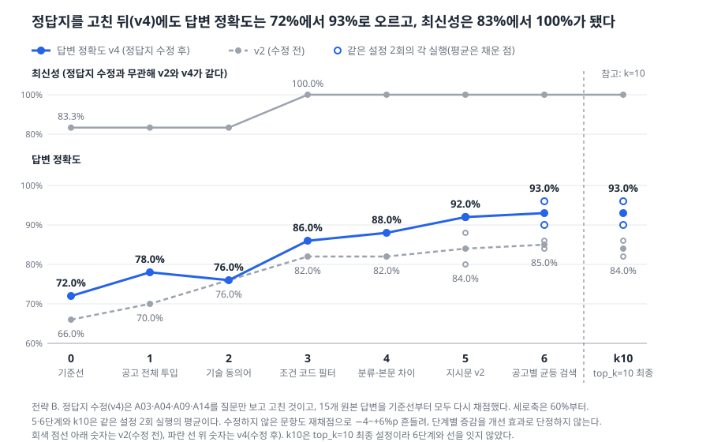
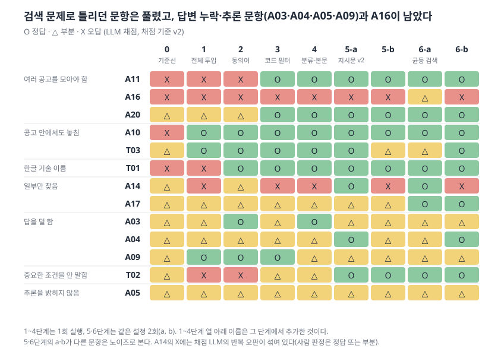
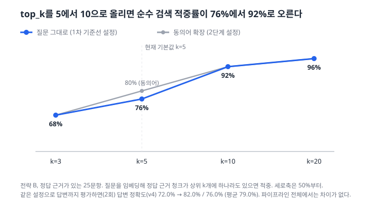

# 채용공고 RAG 챗봇: 만들고, 틀린 걸 찾고, 고쳐서 수치를 올린 기록

작성일 2026-10-12. 점핏(Jumpit) 개발자 채용공고를 근거로 답하는 RAG 챗봇을 만들고, 일반 AI가 틀리는 곳과 내 챗봇이 틀리는 곳을 찾아 고친 과정을 정리한 최종 리포트다. 숫자는 모두 저장소의 문서와 결과 파일에서 가져왔고, 채점 기준은 v4로 통일했다. 출처 문서는 11절에 모았다.

## 0. 한 장 요약

**문제.** 개발자 채용공고는 기업마다 요구하는 기술과 조건이 다르고, 2–4주면 마감된다. 일반 AI에 물으면 일반론으로 답하거나, 마감일을 틀리거나, 공고에 없는 내용을 지어낸다.

**만든 것.** 점핏 공고 140건(서비스용)을 항목 단위로 쪼개 색인하고, 질문의 종류에 따라 검색 범위를 바꿔(전체 · 직무/경력 필터 · 공고 하나) 공고에 있는 내용만 근거로 답하는 챗봇이다. 답변에는 근거 공고와 마감 여부를 붙이고, 공고에 없는 내용은 "확인되지 않습니다"로 답한다. Streamlit 화면과 질문 로그 DB까지 만들었다.

**한 일.** "챗봇 만들었어요"에서 멈추지 않고, 평가셋을 만들어 틀린 문항을 원인별로 분류하고(오답노트), 원인마다 고쳐서 점수가 오르는지 반복 측정했다. 마지막에는 코드를 동결하고 새 문항(홀드아웃)을 한 번만 측정했다.

| 답변 정확도 (채점 기준 v4) | GPT 빈손 | 고치기 전 | 고친 후 (개발 문항) | 고친 후 (홀드아웃) |
|---|---|---|---|---|
| 정답·부분·오답 / 채점 대상 | 2·2·21 / 25 | 15·6·4 / 25 | 22·3·0 / 25, 23·2·0 / 25 | 11·1·1 / 13 |
| **점수** | **12.0%** | **72.0%** | **94.0% · 96.0%** | **88.5%** |

- 최신성(마감 여부) 문항: 고치기 전 2.5/3 → 고친 후 3/3 (홀드아웃도 3/3)
- 출처 정확도(인용 문장이 원문에 실제로 있는 비율): 개발 133/134 · 135/135, 홀드아웃 36/36
- 누적 API 비용: 약 **$0.68**

**배운 것 세 가지**

1. **점수 변화가 개선인지 흔들림인지부터 가려야 한다.** 같은 설정도 6–8%p 흔들려서, 문항 하나 차이는 개선으로 세지 않았다.
2. **결과를 보고 기준을 바꾸면 점수는 쉽게 오른다.** 점수가 오르는 방향으로 채점 기준을 바꾸는 안(v3)은 기각했다. 기준을 고칠 때는 처음 버전부터 전부 다시 채점하고 전·후를 같이 적었다.
3. **개발 중에 본 문항의 점수는 낙관적이다.** 그래서 코드를 동결하고 새 문항을 한 번만 측정했다. 그 값(88.5%)이 개발 문항(94–96%)보다 낮게 나왔고, 이쪽이 일반화에 더 가까운 숫자다.

## 1. 왜 만들었나

취업·이직을 준비하는 신입–3년차 개발자는 공고를 하나씩 열어 요구 기술, 자격요건, 우대사항을 비교해야 한다. 여러 공고를 읽고 비교하는 데 시간이 많이 들고, 내 경험이 어디서 맞고 어디서 부족한지도 한눈에 보이지 않는다.

### 일반 AI는 어디서 틀리나 (예비 확인)

평가셋의 5문항을 ChatGPT 무료 플랜의 기본 모델(웹 검색 사용, 2026년 9월 말)에 같은 방식으로 질문하고 답변을 수집한 공고 원문과 대조했다. 질문마다 새 대화를 열었고, 대상 공고를 이름으로 지정했다.

| 문항 | 질문 내용 | 확인된 문제 |
|---|---|---|
| Q02 | 티엔에이치 백엔드 신입이 요구하는 언어 | 언어(Node.js)는 맞혔지만 진행 중인 공고(10.19 마감)를 "9.19 마감"으로 안내 |
| Q18 | 재택·유연근무가 되는 신입 공고 | 이미 마감된 공고를 추천하고, 진행 중 공고는 마감일을 안내하지 않음 |
| Q22 | 두 회사 자격요건 비교 | 진행 중인 두 공고를 "현재는 마감된 상태"라고 하며 마감일을 한 달 앞당김 |
| Q28 | 쿤텍 공고의 재택근무 여부 | 공고에 없는 "주 1회 재택"을 **출처 링크와 함께** 사실처럼 답변. 링크된 공고에도 재택 내용은 없었음 |
| Q30 | 에이아이콴텍 공고 기준 회사 소개 | 공고에 회사 소개가 없는데 외부 정보로 소개 |

5문항 중 4문항에서 마감일을 틀리거나 마감된 공고를 추천했고, Q02·Q22·Q28은 날짜는 같고 월만 한 달 앞당긴 오류가 반복됐다. 가장 눈여겨본 것은 Q28이다. 출처가 붙어 있어도 그 내용이 출처에 있다고 믿을 수 없다. 그래서 이 프로젝트는 **마감 여부, 출처 정확도**를 정확도보다 먼저 보는 지표로 정했다.

이 확인은 웹 검색을 켠 ChatGPT 5문항의 예비 관찰이다. 7절의 "GPT 빈손"(공고 없이 gpt-6-luna에 물은 것)과는 다른 실험이다.

**확인 조건**

- ChatGPT 무료 플랜의 기본 모델을 썼다.
- 웹 검색을 켜고, 문항마다 새 대화에서 한 번씩 물었다. 공고 선택·필터 범위는 화면에서 고를 수 없으므로 질문 안에 글로 풀어 썼다.
- 질문마다 답변 화면을 캡처해 두었고, 정답과 근거는 평가셋의 같은 문항(Q02·Q18·Q22·Q28·Q30)과 대조했다.
- 표본이 5문항뿐이라 "일반 AI는 이렇다"는 일반화가 아니라, 같은 질문으로 다시 확인할 수 있는 예비 관찰로만 쓴다.

**질문 원문** (그대로 다시 물어볼 수 있다)

| 문항 | 질문 |
|---|---|
| Q02 | 2026년 9월 말 기준 점핏에 올라온 티엔에이치 '백엔드 개발자 (신입)' 공고에서는 어떤 언어로 개발해 봤어야 해? |
| Q18 | 2026년 9월 말 기준 점핏의 신입 공고 중에 재택이나 유연근무 되는 곳 있어? |
| Q22 | 2026년 9월 말 기준 점핏에 올라온 드림어스컴퍼니 '콘텐츠 플랫폼 백엔드 개발(신입)'과 티엔에이치 '백엔드 개발자 (신입)' 공고의 자격요건을 비교해 줘 |
| Q28 | 2026년 9월 말 기준 점핏에 올라온 쿤텍 '임베디드SW/FW개발(신입)' 공고는 재택근무 가능해? |
| Q30 | 2026년 9월 말 기준 점핏에 올라온 에이아이콴텍 '로보어드바이저 IRP 시스템 개발/운영' 공고 보면 어떤 회사야? |

## 2. 데이터

| | 평가용 | 서비스용 |
|---|---|---|
| 수집일 | 2026-09-30 (이후 고정) | 2026-10-08 |
| 목록에서 확인한 공고 | 193건 | 197건 |
| 사용 문서 | **101건** (69개 기업) | **140건** (진행 중 104 · 조기 마감 10 · 마감 26) |

- **수집 범위**: 점핏 서버/백엔드·프론트엔드·웹 풀스택 중 최소 경력 3년 이하. 점핏 웹이 쓰는 목록·상세 API를 코드(`src/collect_jumpit.py`)로 조회하고, 요청마다 간격을 둔다. robots.txt와 사람인 회원약관(제19조)을 확인해 비상업 학습 목적으로만 쓰고 공고 원문은 저장소에 올리지 않는다.
- **다시 수집해도 안전하게**: 이미 있는 공고는 본문이 같으면 "변경 없음"으로 넘기고, 목록에서 사라진 공고는 지우지 않고 상태만 "마감" 또는 "조기 마감"으로 바꾼다. 10/08 재수집에서 새 공고 15건이 추가됐고 마감 처리는 40건으로 기록됐다.
- **품질 기준으로 거른 문서**: 9/30 수집에서 3건(리베코이앤씨)이다. 주요업무 한 줄만 있고 자격요건이 비어 있고, 업무도 기계·설계 직무여서 개발 직군으로 분류된 것 자체가 오류로 보였다.

### 기준을 바꾼 기록

| 바꾼 것 | 이유 | 결과 |
|---|---|---|
| 본문 최소 글자 300자 → 100자 | 내용이 정상인 짧은 공고 9건까지 걸러짐 | 사용 문서 92 → 100건 |
| 제외 사유 "이미지 공고 가능성" → "필수 항목 미기재" | 직접 열어 보니 이미지가 아니라 내용을 안 채운 공고 | 추측이 아닌 확인된 사유만 기록 |
| 첫 번째로 걸린 사유만 기록 → 해당 사유 모두 기록 | 본문 100자 미만에도 해당하는데 0건으로 집계됨 | 100자 미만 0건 → 3건 |

### 점핏 분류와 본문이 다른 공고

- 지피에이코리아: 경력 1–3년으로 등록, 본문 자격요건은 경력 5년 이상
- 코즈코리아: 신입 공고로 등록, 본문은 "경력 3–7년차 수준 예상"
- 쿤텍: 서버/백엔드로 등록, 본문은 임베디드 C/C++
- 휴먼에스: 제목은 PHP 서버개발자, 직무 분류는 기술지원·정보보안·프론트엔드

필터가 점핏 분류만 믿으면 이런 공고를 잘못 걸러낸다. 그래서 필터는 점핏 분류를 쓰되, 질문이 경력·신입을 물을 때는 본문의 경력 조건을 답변에 함께 표시하도록 설계했다 (개선 실험 4단계).

## 3. 시스템

### 청킹

공고 하나를 회사 소개, 주요업무, 자격요건, 우대사항, 복지, 채용절차 6개 항목으로 나누고, 학력·근무지·마감일 질문을 검색으로 찾을 수 있게 **공고 개요 청크**를 하나씩 더 만들었다. 두 가지 전략을 비교했다.

| | 전략 A (항목 단위 그대로) | 전략 B (800자 이상인 항목만 추가 분할) |
|---|---|---|
| 청크 수 | 685개 | 729개 (본문 628 + 개요 101) |
| 평균 길이 | 260자 | 245자 |
| 최대 길이 | 4,474자 | 795자 |
| 800자 이상 청크 | 28개 (4.1%) | 0개 |
| 답변 정확도 (기준선, v4) | 70.0% | 72.0% |

분할은 번호 소제목 → 빈 줄 문단 → 줄바꿈 순으로 시도했다. 정확도 차이는 작았지만 긴 청크에는 관계없는 내용이 섞여 검색이 흐려져서 B로 고정했다.

**청크 수동 검사**: 전략 B 청크에서 무작위 30개를 뽑아 직접 읽었다 (정상 29, 버림 1). 분할 조각 10개를 보충해 봤고(정상 9, 잘림 1), 분할 경계 44곳은 전수 확인했다(정상 40, 잘림 2, 경미 2). 정제 규칙과 판정 사유는 `docs/step3_cleaning_rules.md`, `docs/step3_chunk_review.md`에 있다.

### 질문 하나를 처리하는 방법

1. 사용자가 **공고를 골랐으면** 그 공고 전체를 근거로 넣는다. 다른 공고가 섞일 수 없다.
2. 아니면 질문을 **조건**(학력·재택·마감일·기술·근무지·신입·직무 등 9개)으로 해석해 공고별 칸을 **코드로 필터링**한다. LLM은 결과를 설명만 한다.
3. 조건이 없으면 **검색**한다. 질문의 기술 이름에 동의어를 덧붙이고(스프링 ↔ Spring), 회사 2곳을 비교하는 질문은 공고마다 필요한 항목 청크를 가져오고, 그 밖에는 질문과 가까운 청크 상위 10개를 가져온다.
4. 점핏 분류와 본문이 다른 공고는 그 차이를 근거에 붙이고, 답변 지시문 v2로 답한다.
5. 답변이 인용한 문장이 근거 원문에 실제로 있는지 코드로 확인하고, 마감 여부는 기준일로 **계산**한다. 마감일은 LLM이 쓰지 않고 저장된 값을 그대로 쓴다.

모델은 답변·채점 `gpt-6-luna`, 임베딩 `text-embedding-3-small`, 벡터 DB는 ChromaDB다.

## 4. 평가를 어떻게 설계했나

| | 개발 문항 | 홀드아웃 |
|---|---|---|
| 문항 수 | 30 (정답형 20 · 문서에 없음 5 · 함정 5) | 15 (정답형 10 · 문서에 없음 2 · 함정 3) |
| 용도 | 고치는 동안 계속 봄 | 코드 동결 뒤 새로 쓰고 잠근 뒤, 한 번만 측정 |
| 데이터 | 9/30 스냅샷 101건 | 같은 스냅샷 (개발 문항에 안 나온 공고 위주) |

- **정답 형식**: 질문 + 정답 + 필수 요소 + 근거 위치(공고ID/항목) + "섞이면 안 되는 내용". 정답은 공고 원문을 직접 읽고 정했다.
- **평가 기준일을 2026-10-02로 고정**했다. 9/30 기준이면 101건이 모두 진행 중이라 최신성을 평가할 수 없었고, 12건이 마감 상태가 되는 10/02로 정했다.
- **지표 우선순위**: 최신성 > 출처 정확도 > 답변 정확도 > 검색 적중률. 답변은 정답 1 · 부분 0.5 · 오답 0의 평균이다.
- **자동 실행**: `src/run_eval.py`가 문항을 돌리고 채점한다. 검색 적중·근거 표시·출처 정확도는 코드로, 답변 정확도와 문서에 없음 처리는 LLM으로 채점한다.

### 채점 기준 변경 기록

| 기준 | 바뀐 것 | 기준선 답변 정확도 | 판정 |
|---|---|---|---|
| v1 → v2 | 필수 요소 3개 수정, 근거 표시를 공고ID+항목으로 비교 | 64% → 66% (LLM-사람 일치율 90% → 100%) | 채택 |
| v2.1 | A14 채점 메모에 "경력 공고" 정의 추가 | 66% → 66% | 되돌림 |
| v3 | A04 스톡옵션 제외, A05 추론 구분 선택화 | 66% → 70% | **기각** |
| **v4** | 질문만 보고 정답지 수정(A03·A04·A09·A14), 기준선부터 전부 재채점 | **66% → 72%** | 채택 |

v3를 기각한 이유는 결과를 본 뒤 점수가 오르는 방향으로 기준을 바꾸는 일이기 때문이다. A05는 추론을 밝히는 능력을 재는 유일한 문항이라, 기준을 풀면 그 능력을 재지 못하게 된다. v4는 강사님 피드백("정답지는 질문만 보고 고치고, 고치면 처음 버전부터 전부 다시 채점하고, 전·후 점수를 같이 적는다")에 따라 처음 버전부터 15개 답변을 모두 다시 채점했다. 수정한 4문항의 몫은 +2–10%p였고, 수정하지 않은 문항도 재채점 변동으로 −4에서 +6%p 바뀌어서, 단계별 증감을 개선 효과로 단정하지 않는다.

## 5. 오답노트: 어디서 틀렸나

1차 기준선(전략 B, 상위 5개 검색)에서 답변이 완전히 맞지 않은 문항은 13개였다(오답 4 + 부분 9). 당시 채점 기준(v2)으로 답변 정확도는 66.0%였다.

| 실패 유형 | 문항 수 | 점수 손실 | 비중 |
|---|---|---|---|
| **검색 실패** (근거 청크를 못 가져옴, 부분 적중 포함) | 8 | 6.0점 | **71%** |
| **생성 왜곡** (찾았는데 답을 덜 하거나 조건을 안 말함) | 5 | 2.5점 | 29% |
| 문서에 없음 | 0 | 0 | 0% |
| 질문 모호 | 0 | 0 | 0% |

문서에 없는 질문 5개는 모두 "확인되지 않습니다"로 정확히 답했다. 문제는 **있는 내용을 없다고 답한 경우** 5건이었다.

| 문항 | 무슨 일이 있었나 | 원인 |
|---|---|---|
| A10 "전형 어떻게 돼?" (공고 선택) | 정답이 있는 채용절차 청크가 상위 5개에 못 들어감. 답변은 "전형 절차가 확인되지 않습니다" | 같은 공고의 다른 5개 항목이 순위를 채움 |
| T01 "스프링 써 본 사람 뽑는 곳?" | 질문은 한글 "스프링", 공고는 영문 "Spring Framework". 답변은 "확인되지 않습니다" | 한글-영문 기술 이름 연결 실패 |
| A17 두 회사 자격요건 비교 | 상위 5개가 모두 한 회사 청크라 다른 회사는 "확인되지 않습니다" | 비교 질문을 검색 하나로 처리 |
| A03 쿤텍 신입이 할 줄 알아야 할 언어 | 정답 청크는 찾았지만 "시스템 프로그래밍"을 빼고 답함 | 생성 왜곡 |

A03은 나중에 정답지를 고쳐서(채점 기준 v4, 4절) 풀린 문항이다. A04·A09·A14도 마찬가지로 모델 개선 효과가 아니라 정답지 수정 효과다.

이 표가 개선 순서를 정했다. 점수 손실의 71%가 검색 실패라서 검색과 범위 쪽부터 고쳤다.

## 6. 개선 실험

판정은 채택 / 수정(부작용을 찾아 설계를 고침) / 기각 / 되돌림 / 참고로 나눴다. 점수는 모두 채점 기준 v4, 전략 B, 평가 기준일 10/02다. 5단계부터는 같은 설정을 2회 돌려 노이즈를 재고, 두 번 모두 나아진 문항만 개선으로 셌다.

| 단계 | 바꾼 것 | 답변 정확도 | 판정과 이유 |
|---|---|---|---|
| 기준선 | 전략 B, 상위 5개 | 72.0% | 시작점 |
| 1 | 공고를 고르면 그 공고 전체를 근거로 투입 | 78.0% | 채택. 같은 공고 안에서 정답 항목이 밀리던 문제(A10·T03) 해소 |
| 2 | 기술 동의어 사전으로 검색 질문 확장 | 76.0% | 채택. T01 해결, 단 점수 기여는 없고 문항 단위 효과만 확인 |
| 3 | 학력·재택·마감일·기술을 공고별 칸으로 뽑아 **코드로 필터** | 86.0% | 채택. **최신성 83.3% → 100%**, 임베딩으로 못 찾던 조건 검색이 정확해짐 |
| 4 | 점핏 분류와 본문이 다르면 답변에 표시 | 88.0% | **수정**. 처음엔 모든 답변에 붙여서 무관한 질문에도 경력 문장이 붙었고, 질문이 경력·신입을 물을 때만 붙이도록 고침 |
| 5 | 답변 지시문 v2 (항목 누락 방지, 지원 가능 여부는 결론부터) | 92.0% / 92.0% | 채택. 효과가 확인된 문항은 T02 하나이고 평균 +4%p는 노이즈 범위 |
| 6 | 공고별 균등 검색 (공고마다 질문이 묻는 항목 청크를 가져옴) | 96.0% / 90.0% | 채택. 첫 안은 개요·복지만 가져와 실패해서 수정. A17 일관되게 개선 |
| 7 | 상위 5개 → 10개 | 90.0% / 96.0% (6단계 시점, 최종 측정은 7절) | 검색 단독 적중률 76% → 92%. 최종 파이프라인에서는 차이 없음, 서비스 기본값 10 |

범위에서 뺀 것: 모델 변경(상위 모델은 단가가 20배라 보류), 임베딩 교체, 청킹 전략 추가 비교. 시간과 비용을 쓸 곳을 정해야 해서, 오답노트에서 손실 비중이 큰 검색·범위 문제에 집중했다.

**읽는 법**

- 효과가 분명히 확인된 곳은 3단계(조건을 코드로 필터), T02, A17, T01, A10·T03 정도다. 나머지 단계의 점수 변화는 노이즈 범위가 섞여 있다.
- 채점 LLM도 흔들린다. A14는 정답 6곳이 모두 있어도 "경력 공고 섞임"으로 반복 오답 처리됐고, "문서에 없음" 문항은 마감일 줄을 덧붙였다고 오답 처리되는 경우가 있었다.
- 6단계까지 남은 틀린 문항은 둘이다. A16(서버 개발 공고만 골라 종합: 직무 분류와 본문의 차이)과 A05(추론했다는 사실을 밝히지 않음).

## 7. 최종 측정

개선은 6단계에서 멈췄고, 마지막으로 이렇게 측정했다.

1. **코드 동결**: 커밋 `a990a4b`(태그 `freeze-final`) 이후 검색·프롬프트·규칙·평가셋을 고치지 않는다. 채점 기준도 v4로 동결했다. 동결 뒤 바뀐 파일은 문서·문항·결과·화면뿐이고, 동결 대상 파일의 차이는 비어 있다.
2. **홀드아웃 잠금**: 코드 동결 이후에, 공고 원문만 보고 15문항과 정답지를 써서 시스템에 한 번도 돌리기 전에 커밋했다(`a1339dc`).
3. **측정**: 빈손 재채점, 개발 문항 2회, 홀드아웃 딱 1회.

| 지표 | GPT 빈손 | 고치기 전 | 고친 후 (개발) | 고친 후 (홀드아웃) |
|---|---|---|---|---|
| **답변 정확도** | 12.0% | 72.0% | 94.0% · 96.0% | **88.5%** |
| 문서에 없음 처리 | 3/5 | 5/5 | 5/5 · 5/5 | 2/2 |
| 최신성 (3문항) | 0/3 | 2.5/3 | 3/3 · 3/3 | 3/3 |
| 출처 정확도 (인용 통과/인용 수) | 인용 없음 | 69/69 | 133/134 · 135/135 | 36/36 |
| 검색 적중 | 해당 없음 | 19/25 | 7/7 · 7/7 | 3/6 |
| 채점자 | AI | AI | AI | AI + 사람 15/15 일치 |

검색 적중의 분모는 열마다 다르다. 고치기 전은 모든 문항을 검색으로 처리해 25문항이고, 고친 후는 공고 선택·조건 필터 문항이 검색이 아닌 경로로 처리돼 검색 경로 문항만 센다(개발 7, 홀드아웃 6). 세 값을 직접 비교하면 안 된다.

**읽는 법**: 공고를 근거로 쓰는 것만으로 +60%p(12.0% → 72.0%), 6단계까지의 개선으로 +22–24%p가 더 올랐다. 홀드아웃은 채점 대상이 13개라 한 문항이 7.7%p를 움직여서, 개발 문항과의 차이(5.5–7.5%p)는 한 문항 안팎이다. 방향은 "새 문항에서 조금 낮다"이고 크기는 확정하기 어렵다.

**개발 문항 94.0%·96.0%와 6단계 값(90.0%·96.0%)의 차이**: 6단계 시점(10/06)에 같은 설정(상위 10개 최종 파이프라인)을 2회 돌렸을 때는 90.0%와 96.0%였고, 코드를 동결한 뒤 10/08에 다시 돌린 값이 94.0%와 96.0%다. 두 번째 실행(b)은 그대로이고 첫 번째 실행(a)이 두 문항(4%p) 올랐다. 동결 코드에는 6단계 이후 7단계 변경(조건 해석 확장, 조기 마감 상태 수정)이 들어 있어서 두 실행의 코드가 같지는 않다. 다만 같은 설정도 6–8%p 흔들리는 것이 확인돼 있어서, 올라간 이유가 코드 변경인지 실행 간 흔들림인지는 구분하지 않았고 개선 효과로 말하지 않는다. 대표 숫자는 코드를 동결한 뒤 홀드아웃과 같은 조건으로 측정한 이 값(94.0%·96.0%)을 쓴다.

### 홀드아웃에서 틀린 문항 (고치지 않음)

| | 질문 | 무슨 일이 있었나 |
|---|---|---|
| H01 (오답) | 와탭랩스 백엔드 개발자 채용은 전형이 어떻게 돼? | 정답 청크가 상위 10개에 없고 다른 회사 청크가 섞여 "확인되지 않는다"로 답함 |
| H02 (부분) | 오투플러스 백엔드 개발자는 어떤 언어를 해 봤어야 해? | 같은 회사 프론트엔드 공고 청크가 들어와 "필수 여부는 확인되지 않는다"로 답함 |

원인은 둘 다 **검색 실패**다. 같은 회사에 공고가 여러 개일 때, 회사명·직무명만으로 특정 항목을 물으면 질문과 가까운 청크 상위 10개를 가져오는 일반 검색이 공고를 특정하지 못한다. 안전한 실패였다는 점은 확인했다. 다른 공고 내용을 섞거나 지어내지 않고 "확인되지 않는다"는 쪽으로 답했고, 출처 정확도와 최신성에는 영향이 없다. 동결 규칙대로 홀드아웃 결과를 보고 파이프라인을 고치지 않았다. 개선 방향은 질문의 회사명·직무명으로 공고를 먼저 특정한 뒤 그 공고 안에서 항목을 찾는 것이다 (구현하거나 효과를 확인하지 않았다).

H10은 지표 해석 주의 사례다. 답은 정답이었는데 검색 적중이 X로 나온 것은 정답 근거로 둔 개요 청크를 가져오지 않았기 때문이고, 마감일은 모든 청크 머리글에 있어서 개요 없이도 답할 수 있었다. 항목 단위로 채점하는 지표가 이 문항의 답 정확도를 과소평가했다.

## 8. 서비스화

- **엔진**(`src/rag_engine.py`): 3절의 처리 흐름을 질문 하나씩 처리한다. 평가 코드를 그대로 가져다 쓰고 데이터셋(평가용/서비스용)과 기준일만 바꿔 끼워서, 평가 결과와 같은 동작을 낸다.
- **화면**(`src/app.py`, Streamlit): 사이드바에서 직무·신입 필터, "마감 공고도 포함" 스위치, 공고 하나만 골라 묻기. 답변에는 근거 공고 카드(상태 배지, 마감일, 점핏 링크), 응답 시간·비용·기준일·처리 방식을 한 줄로 보여 주고, 마감 공고가 근거에 있으면 경고한다. 수집일과 마감 판정 기준일이 다르면 안내한다.
- **로그 DB**(`src/log_db.py`, SQLite): 질문, 범위, 처리 방식, 답변, 출처, 인용 확인 수, 토큰, 비용, 응답 시간, 오류, 👍/👎 피드백을 저장한다. 원문 인용이 들어 있어 비공개이고, 공개용 CSV는 답변·인용·질문 원문을 빼고 내보낸다.
- **써 보고 고친 것**: "서울에서 일하는 곳만 알려줘"가 지원하지 않는 조건이라 검색으로 처리됐다. 신입 범위 14건에서는 정답 8곳 중 7곳, 범위가 전체(101건)면 정답 55곳 중 3곳만 나왔고 사용자는 누락을 알 수 없었다. 그래서 근무지·신입·직무를 조건 해석에 추가해 코드로 필터링했다 (신입+서울 8곳, 전체+서울 55곳이 공고 표와 일치). 또 건수 표기를 "진행 중 N건 / 전체(마감 포함) N건"으로 나눴고, 조기 마감 공고가 답변에서 "진행 중"으로 표시되던 오류를 고쳤다.
- **서비스용 데이터 전환**(10/08): 재수집(사용 문서 125 → 140건) → 청킹(전략 B 1,002청크) → 색인 → 칸 추출까지 $0.0386.
- **운영 숫자**: 질문 한 건 응답은 6초 안팎, 엔진 점검 기준 질문당 약 $0.0005. 앱 로그 24개 질문에서 인용 266개 중 259개(97.4%)가 확인을 통과했고, 실패 7개는 모두 원문 불릿 문자를 바꾸거나 줄을 합친 표기 차이였다(지어낸 인용 없음).

이력서와 비교해 부족한 역량을 알려 주는 기능(제안서의 확장 기능)은 이번 범위에 넣지 않았다.

## 9. 한계와 다음 과제

**측정의 한계**

- 홀드아웃은 15문항(채점 대상 13개)이라 한 문항이 6.7–7.7%p를 움직인다. 개발 문항과의 차이를 확정적으로 해석하지 않는다.
- 홀드아웃 공고 모음은 개발 때와 같은 9/30 스냅샷이다. 3문항(H06·H07·H10)은 개발 문항에 쓴 신입 공고군을 쓴다.
- 항목을 찾는 낱말 규칙, 기술 동의어 사전, 조건 해석 규칙은 평가 문항의 실패를 본 뒤에 만들었다. 홀드아웃이 이 오염을 일부 확인해 주지만 완전히 막지는 못한다.
- 개발 문항은 같은 설정을 2회만 실행했다. 두 실행의 차이(94.0%·96.0%)가 흔들림의 크기를 보여 준다.
- 채점은 AI가 했고, 사람 확인은 홀드아웃 15문항에 한정된다. 채점 LLM의 판정은 같은 답변이라도 한두 문항씩 흔들린다.
- **서비스용 데이터(140건)에는 정답 기준 평가셋이 없어서 서비스용 정확도 수치는 없다.**

**시스템의 한계**

- 조건 해석이 지원하지 않는 조건(연봉, 복지, 회사 규모, 고용 형태, 전형 단계 등)은 청크 검색으로 넘어가 일부 공고만 나오고, 사용자는 누락을 알 수 없다. 질문에 지원 조건과 미지원 조건이 섞이면 미지원 조건은 조용히 무시된다.
- 같은 회사에 공고가 여러 개일 때 항목을 묻는 질문은 검색이 공고를 특정하지 못한다 (H01·H02).
- 로그의 "인용 확인 실패"는 표기 차이까지 실패로 센다. 화면에는 영향이 없다.
- 응답이 6초 안팎이고 길면 20초가 넘는다(LLM 호출이 두 번).
- 데이터가 점핏 한 곳이라 스타트업·중소기업 위주이고 대기업 공채 정보는 없다. 공고는 2–4주면 마감되어 서비스용 데이터는 다시 수집·색인해야 한다.

**다음에 한다면**

1. 질문의 회사명·직무명으로 공고를 먼저 특정하고 그 안에서 항목을 찾는 2단계 검색 (H01·H02 대응)
2. 필터로 못 거르는 조건에 "목록이 불완전할 수 있다" 경고 붙이기, 칸이 이미 있는 경력 연차·상시채용·회사 조건부터 추가
3. 서비스용 데이터 기준 평가셋 만들기와 사람 채점 범위 넓히기
4. 이력서 비교 기능, 원티드 등 다른 채용 사이트 추가 (약관·robots.txt를 사이트마다 확인)

## 10. 비용과 재현

| 항목 | 비용 |
|---|---|
| 평가·실험 | $0.427 |
| 7단계 엔진 점검 | $0.085 |
| 정답지 수정(v4) 재채점 | $0.073 |
| 서비스용 색인·칸 추출 | $0.039 |
| 최종 측정 (실행 $0.055 + 채점 점검 $0.003) | $0.058 |
| **합계** (`eval/usage_log.csv`) | **약 $0.68** |

앱 질문 로그(2026-10-08 기준 24개 질문 $0.037)는 계속 쌓이는 값이라 별도이고, 서비스용 점검 질문 $0.014는 어느 로그에도 없다.

- **최종 설정 명령**과 동결 확인 방법(`git diff freeze-final..HEAD -- <동결 대상 파일>`이 비어 있어야 한다)은 `docs/step8_final_measurement.md`에 있다.
- **실행 방법**은 저장소 `README.md`에 있다. 다만 평가를 같은 조건으로 재현하려면 9/30 수집본의 공고 원문과 청크(둘 다 비공개)가 필요하고, 공고는 마감되면 내려가므로 지금은 같은 원문을 다시 받기 어렵다. 그래서 결과 파일(`eval/results/`)과 지표 한 줄씩의 기록(`eval/results/summary.csv`)을 남겨 두었다.

## 11. 문서 지도

| 내용 | 문서 |
|---|---|
| 제안서 | `docs/proposal.pdf` |
| 데이터 카드 (수집, 제외 기준, 기준 변경 기록) | `data/README.md` |
| 정제 규칙, 청크 통계, 메타데이터, 청크 수동 검사 | `docs/step3_*.md` |
| 평가셋 설명, 채점 기준, 일치율 | `eval/README.md` |
| 오답노트 | `docs/step5_error_notes.md` |
| 실험 로그 (실험별 전→후, 판정, 비용, 커밋) | `docs/step6_experiment_log.md` |
| 서비스화 | `docs/step7_service.md` |
| 최종 측정 (동결, 홀드아웃, 열별 결과 파일) | `docs/step8_final_measurement.md` |
| 결과·비용 | `eval/results/`, `eval/results/summary.csv`, `eval/usage_log.csv` |
